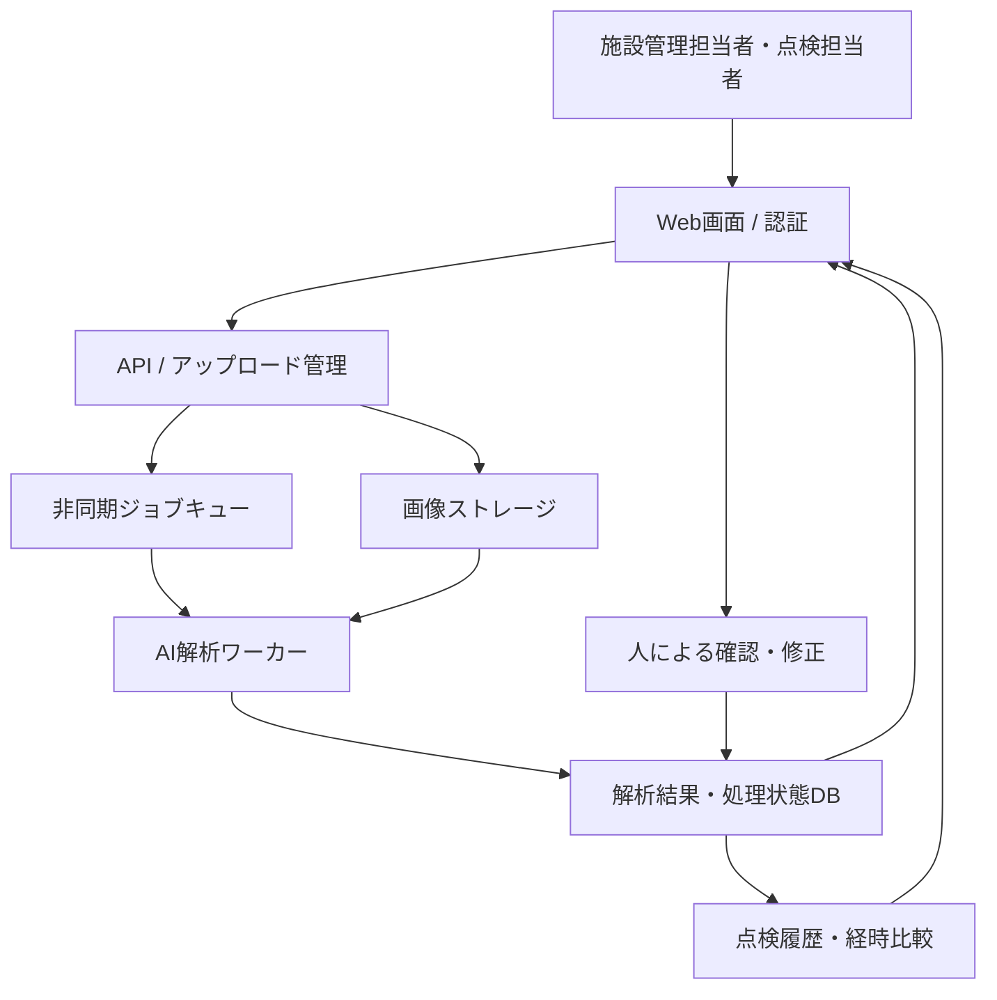

# 現場導入・事業価値の検討

> 2026年11月26日追記（提出後の構想整理）。本資料は面接で述べた大学施設管理への応用案を整理したものです。以下の構成、運用フロー、評価指標は提案であり、実装済みの機能、導入実績、確認済みの効果ではありません。

## 1. 対象顧客と課題

対象として想定するのは、大学キャンパスの施設管理部署です。大学では複数の建物の定期点検、修繕計画、予算配分、記録の引き継ぎなどが必要になります。ひびわれの危険性は幅だけで決まるものではなく、位置、原因、進行状況、構造や環境条件を専門家が総合的に判断する必要があります。

提案の目的は AI による安全性の自動判定ではなく、画像と過去の点検記録を整理し、担当者が詳しく確認すべき箇所の候補を見つけやすくすることです。まず施設管理部署と点検担当者にヒアリングし、撮影・記録・報告・修繕計画のうち、どの作業が負担になっているのかを把握します。

## 2. 業務フローの提案

| 工程 | 提案する支援 |
| --- | --- |
| 撮影 | 建物・階・部位・撮影日時・撮影条件を画像と関連付ける |
| 解析 | ひびわれ検出結果と P コン跡の候補を併せて表示する |
| 人による確認 | 元画像と解析結果を並べ、誤検出・見逃しを確認・修正する |
| 経時比較 | 同じ位置の過去画像との比較により、変化が大きい箇所を確認する |
| 修繕計画 | 専門家の診断、建物の利用状況、予算等と併せて優先度を検討する |
| 記録管理 | 点検履歴、修正履歴、判断の根拠を担当者間で共有する |

経時比較では撮影距離・向き・尺度の違いを考慮する必要があります。画像だけから正確なひびわれ幅や構造上の危険性を判断できるとは限りません。既存の点検要件や専門家の判断は維持します。

## 3. クラウド構成案

画像をアップロードした後にジョブ ID を返し、解析処理を非同期化します。画面では未処理、処理中、確認待ち、完了、失敗を区別します。元画像・予測・修正履歴・モデルバージョンを関連付け、後から判断の根拠を追跡できる構成を想定しています。

### 障害時の設計

| 状況 | 対応案 |
| --- | --- |
| 一時的な通信エラー | 再試行間隔を徐々に延ばし、回数上限を設ける |
| 更新の重複 | 処理 ID と冪等キーを用い、重複登録を抑制する |
| 担当者の修正中に通信が切れる | 機密性に配慮した一時保存と再送を設計する |
| 結果取得に失敗 | 最後に取得できた情報と更新日時を表示し、古い情報であることを明示する |
| モデル更新時に性能が低下 | モデルをバージョン管理し、事前検証と段階的切替、旧版への復帰を可能にする |

認証・権限管理、監査ログ、通信や保存時の暗号化、データ保持期間についても、顧客の要件を確認した上で設計します。

## 4. 実証実験と評価指標

最初から全施設への導入を前提にするのではなく、数棟を対象に既存の点検業務と並行して試行します。導入前後の条件をできるだけ揃え、効果と安全性を確認した上で対象範囲を拡大します。

| 観点 | 計測候補 |
| --- | --- |
| 業務効率 | 画像整理、解析結果の修正、報告書作成に要する時間 |
| 品質・安全性 | 専門家の確認結果との一致、見逃し件数、修正件数 |
| 利便性 | 担当者の操作負担、記録検索時間、引き継ぎのしやすさ |
| 経済性 | 点検一件当たりの総費用、導入・運用費用、継続利用の意向 |
| 運用品質 | 処理成功率、障害からの復旧、結果の更新遅延 |

具体的な改善目標は、実際の業務量や既存の基準を確認して顧客と合意します。AI の F1 が向上しても、点検時間や安全性が改善するとは限らないため、技術指標と業務指標を分けて検証します。

## 5. 顧客価値と自社価値

顧客にとっては、記録整理や誤検出確認の負担軽減、経時変化の把握、専門家による修繕判断の支援が期待できます。自社にとっては、継続的な点検・データ管理サービスへの発展や、学校、病院、公共施設などへの横展開の可能性があります。ただし、需要、価格、導入コスト、収益性は未検証です。

社内提案では、顧客課題の根拠、試作範囲、必要な開発工数、安全上の制約、実証実験の判断基準を明確にし、小規模な検証から投資判断につなげます。

## 6. FDEとしての考え方

現場の課題を理解し、技術の適用可能性を検討し、小さな実証実験から学び、結果に基づいて改善することを重視します。モデルを作ること自体を目的とせず、顧客の業務における具体的な価値と技術的な実現性の両方を確認します。

[技術設計・検証レポート](TECHNICAL_REPORT.md) / [実験比較とモデル選択](MODEL_COMPARISON.md)
