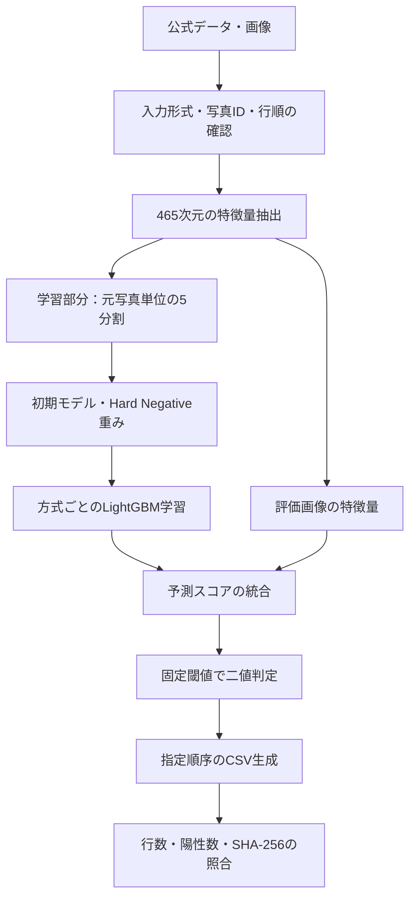

# 技術設計・検証レポート

> 2026年11月26日追記（提出後の補足資料）。本資料は実装の設計意図と開発時の検証観点を整理したものであり、新規の学習・予測結果や評価対象の変更を伴いません。提出用ソースの基準は [commit 05a44d1](https://github.com/zifan0011-create/FUJIFILM-AI-FDE-Hackathon-2026/tree/05a44d1ed10a6edf14a9efe1e3978df9f7ad4549) です。実行手順は [README](../README.md) を参照してください。

## 1. 課題設定と設計方針

コンクリート壁面の 256 × 256 ピクセルの画像から P コン跡の有無を判定する二値分類に取り組みました。学習用の正例は 10,079 枚中 194 枚と少なく、限られた時間と CPU 環境で開発する必要がありました。

そこで、対象物の形状や周辺との明暗差を利用する特徴量設計と、表形式データに適した LightGBM を組み合わせました。優先したのは、単純な正解率ではなく、誤検出と見逃しのバランス、未知の元写真への汎化、そして提出結果の再現性です。

| 課題 | 設計上の対策 |
| --- | --- |
| 正例が少ない | F1 を評価指標とし、誤検出しやすい負例を重点的に学習 |
| 同じ元写真に由来するタイルの類似性 | 元写真 ID 単位の分割 |
| 暗い孔・明るい充填跡・画像端の部分的な構造 | 符号付き多尺度応答、局所構造、境界特徴量 |
| 撮影条件や元写真ごとのサンプル数の違い | 学習画像の拡張、写真・クラスごとの重み補正 |
| 評価と再現の不整合 | 固定分割、固定閾値、依存バージョン、CSV の SHA-256 照合 |

## 2. 処理全体の構成

特徴量キャッシュを共有することで、モデル比較のたびに同じ画像処理を繰り返す必要を減らしました。評価画像は特徴量抽出と推論の対象に限定し、モデル学習には学習用画像と公式学習ラベルを使用します。

## 3. 特徴量エンジニアリング

画像を双線形補間で 128 × 128 に縮小し、次の特徴量を連結します。すべて固定の画像処理から算出され、外部の学習済み特徴抽出器を必要としません。

| ブロック | 次元数 | 設計意図 |
| --- | ---: | --- |
| 符号付き Difference of Gaussians (DoG) | 48 | 異なる大きさの暗い孔と明るい充填跡を捉える |
| 連結成分の形状 | 30 | 面積、縦横比、充填率、境界からの距離を表現 |
| テクスチャ・勾配 | 22 | コンクリートの粒状性や方向性のある構造との区別 |
| 局所正規化 DoG・円環応答 | 88 | 中心と周囲の明暗差、円周方向の整合性、見えている円環の割合 |
| 局所連結成分 | 64 | 円形候補の形状や画像境界との関係 |
| 局所色・テクスチャ | 48 | 局所的な色差、粒状性、輝度変動 |
| 多尺度 Hessian・放射方向勾配 | 108 | 中央と境界の複数候補から孔状構造を捉える |
| 境界帯の統計 | 54 | 長く連続する影や端部の暗い構造を表現 |
| 明暗統計 | 3 | 画像全体の明暗分布を補足 |
| **合計** | **465** | |

DoG では平滑化スケールの差をとり、応答の正負を分けて扱います。局所正規化では周囲の輝度変動を利用し、Hessian の候補抽出では複数スケール・明暗の両符号・画像の中央と境界を区別します。これにより、円形だけに依存せず、部分的な P コン跡や背景の影に関する情報も分類器に渡せます。

実装: [features.py](../features.py)

## 4. 学習方法とモデルの比較

### 元写真単位の検証

ランダムなタイル単位の分割では、同じ元写真の背景や照明の特徴が学習側と検証側に共有されるおそれがあります。そこで StratifiedGroupKFold を利用し、クラスの偏りに配慮しながら元写真を分離しました。固定 5 分割のマニフェストをハッシュで照合し、再現実行時に意図しない分割変更が起きないようにしています。

### Hard Negative の再重み付け

各学習フォールドで初期モデルを学習し、その学習部分の負例の陽性スコアを計算します。上位約 2% の負例に重み 3、残りのサンプルに重み 1 を与えて再学習します。影や構造物の端など、誤検出の原因になりやすい特徴に対する識別能力の改善を狙った設計です。

重みの決定に検証フォールドのラベルを使用しない点が重要です。一方、初期モデル自身の学習部分に対するスコアで負例を選ぶため、難負例の選択には学習への適合度の影響もあり得ます。

### 再現対象の5方式

| 方式 | 構成 | 固定閾値 | 主な比較目的 |
| --- | --- | ---: | --- |
| C04 | Hard Negative × 5、等重み | 0.20427700824353937 | 基本構成 |
| C05M2-J | 学習時の3ビューを 0.50 / 0.25 / 0.25 で重み付け、5モデル | 0.15873688188386165 | 明暗・方向変化への対応 |
| C05M2-Final | 5フォールドごとに難負例モデル 0.80、通常モデル 0.20 | 0.16461504711798983 | 異なる学習方法の相互補完 |
| C05M2-F | 全学習データで再学習する単一モデル、写真・クラスごとの重み補正 | 0.09902811548177957 | 特定の元写真への学習寄与の集中を緩和 |
| C05M2-E5 | C04 の5モデルを再利用 | 0.1937088038619091 | 分類閾値の影響 |

Final の統合スコアは、各フォールドの Hard Negative モデルと通常モデルのスコアを 0.8 : 0.2 で融合し、その5組を等重みで平均したものです。F の補正では、既存重みを同一元写真・同一クラスの件数の 0.25 乗で割り、各クラスの重み総和を補正前の値に戻します。J の拡張は学習用画像のみを対象とし、元画像と拡張画像の重みの合計を維持します。

実装: [c04.py](../c04.py)、[c05m2.py](../c05m2.py)

## 5. 評価・誤分類分析と学び

F1 は精度（Precision）と再現率（Recall）の調和平均であり、正例が少ない条件で、誤検出と見逃しの両方を考慮できます。開発では、元写真単位の F1 に加えて、誤検出数（FP）・見逃し数（FN）や写真ごとの性能変化も比較する方針としました。

- 影・画像端の暗い構造を誤認するケースと、小さい・部分的・低コントラストの跡を見逃すケースを分けて考えました。
- ローカルの交差検証と公式の Public 評価の順位が必ずしも一致しないことから、撮影条件、陽性率、分類閾値の推定方法、限られた元写真でのモデル選択などを検討しました。
- 単一モデルの検証スコアと複数モデルの平均スコアでは、分布が変わる可能性があります。閾値の比較では、実際の推論構成に対応した検証方法が望ましいと考えています。
- データ拡張や重み補正は常に改善を保証するものではありません。異なる分割で効果が変わり得るため、平均値だけでなく性能のばらつきも見る必要があります。

ここで挙げた要因は開発時の分析観点であり、非公開評価データにおける性能差の原因を特定したものではありません。探索段階で比較した SVM や CNN などの全実験コードは、この再現用リポジトリには含まれていません。

## 6. 再現性と品質管理

| 確認項目 | 実装 |
| --- | --- |
| 入力 | パス形式、重複、空ファイル、学習と評価の元写真の重複を検査 |
| 分割 | 固定5分割のマニフェストを SHA-256 で検証 |
| 特徴量 | 465次元の行列、有限値チェック、入力一覧とキャッシュ識別子の照合 |
| 学習 | パラメータ、シード、ライブラリのバージョンを固定 |
| 出力 | 8,059行、二値ラベル、公式の行順、方式ごとの陽性数、CSV 全体の SHA-256 を検証 |

開発環境では C04 の元画像からの一連の再現と、改善方式の既存特徴量キャッシュを用いた CSV 再現が確認されています。これは異なる OS・ライブラリ環境でのビット単位の再現性や、公式評価への反映を保証するものではありません。また、同一ハッシュは出力の同一性を示すものであり、未知データでの性能を証明する指標ではありません。

## 7. 今後の検証

実運用を想定する場合は、開発時に繰り返し用いた元写真と独立したデータで評価し、施設・撮影機材・照明条件ごとの性能を確認する必要があります。P コン跡の周辺に実際のひびわれが存在する場合も考慮し、AI の判定のみで損傷候補を除外しない設計が重要です。

現場向けの活用構想は [現場導入・事業価値の検討](DEPLOYMENT_CONCEPT.md) を参照してください。
